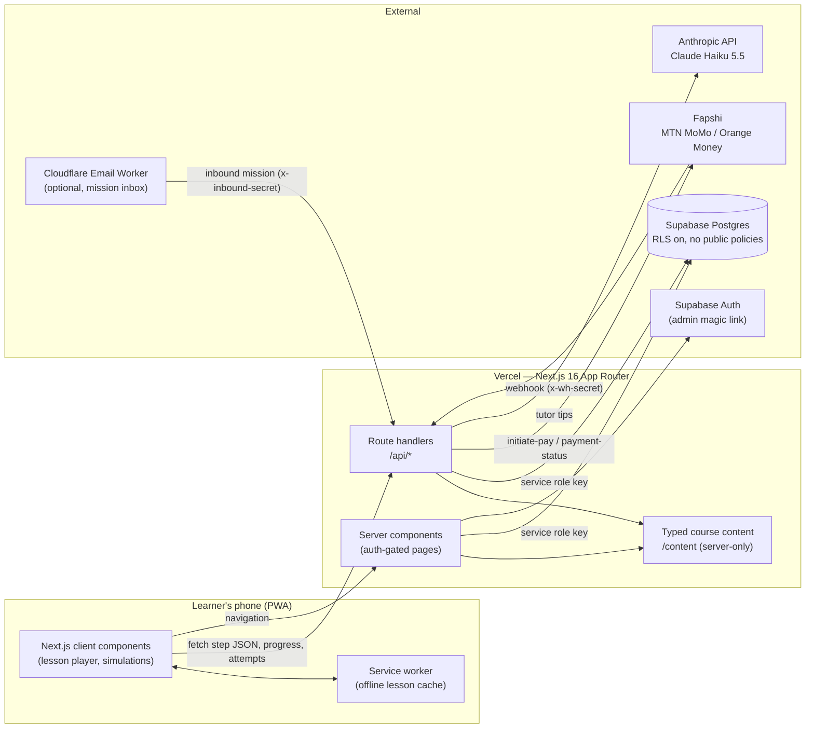
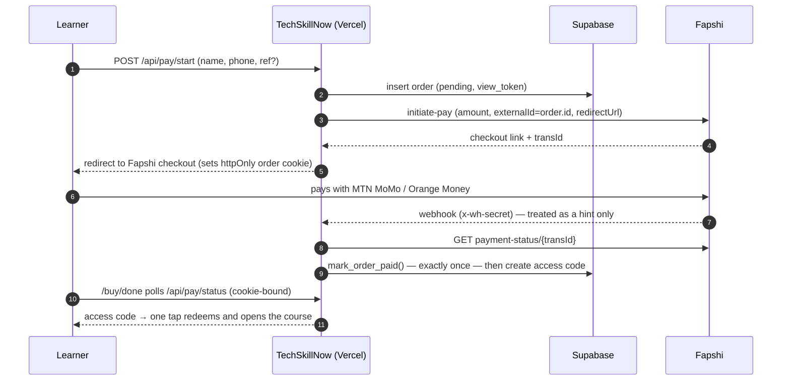

# TechSkillNow

**Professional digital skills for Cameroonian learners — taught step by step, on the phone they already own.**

TechSkillNow is a mobile-first Progressive Web App that teaches practical workplace skills through short lessons and realistic, interactive simulations. Learners study entirely in the browser, in English or French, on low-cost Android phones and slow networks. Each course is sold once, paid by MTN MoMo or Orange Money, and unlocked with a one-time access code.

| Course | Outcome | Price |
|---|---|---|
| **Email for Work** | Writes and sends professional emails, spots scams, and sends a real job application from Gmail | 850 FCFA |
| **A CV That Gets Interviews** *(Get the Job · 1 of 4)* | Finishes with their own tailored, ATS-friendly CV as a PDF, checked by a real-email mission | 1 000 FCFA |
| **Applications That Get Answers** *(Get the Job · 2 of 4)* | Leaves with a tailored cover letter, a networking profile and a real application sent, and handles every kind of reply | 1 000 FCFA |
| **Chemistry Practicals: Titration and Salt Analysis** *(GCE Practicals · Chemistry, prototype: lab basics and titration)* | Titrates on a virtual SVG bench, writes the method the way examiners mark it, calculates concentrations, and passes a timed mock | 1 000 FCFA |

| | |
|---|---|
| **Production domain** | [techskillnow.com](https://techskillnow.com) *(registration pending verification — use the Vercel URL until it resolves)* |
| **Live deployment** | [techskillnow.vercel.app](https://techskillnow.vercel.app) |
| **Admin console** | [techskillnow.vercel.app/admin](https://techskillnow.vercel.app/admin) |
| **Certificate verification** | `https://<domain>/verify/TSN-XXXX-XXXX` |
| **Repository** | [github.com/Ngum12/Techskillnow](https://github.com/Ngum12/Techskillnow) |
| **Hosting** | Vercel (auto-deploys on every push to `main`) |
| **Prices** | Set per course in `/content` (850 FCFA and 1 000 FCFA at launch) |

---

## Contents

- [Why TechSkillNow](#why-techskillnow)
- [Features](#features)
- [Architecture](#architecture)
- [Security model](#security-model)
- [Tech stack](#tech-stack)
- [Project structure](#project-structure)
- [Data model](#data-model)
- [Getting started](#getting-started)
- [Environment variables](#environment-variables)
- [Content authoring](#content-authoring)
- [Payments (Fapshi Mobile Money)](#payments-fapshi-mobile-money)
- [Real-world mission](#real-world-mission)
- [Deployment](#deployment)
- [Testing and quality](#testing-and-quality)
- [Performance and offline](#performance-and-offline)
- [Roadmap](#roadmap)

---

## Why TechSkillNow

Most job applications in Cameroon now arrive by email, yet many capable candidates have never been taught to write one — and most of them learn on a phone, not a laptop. TechSkillNow closes that gap with:

- **Practice, not videos.** Every skill is rehearsed on simulated screens (a Gmail-style composer, inbox and sign-up flow) that check the learner's work and explain exactly what to fix.
- **Built for the real network.** A tiny JavaScript footprint, WebP illustrations, no video, and offline access to lessons already opened.
- **Bilingual by design.** Full English and French versions, including French-language writing checks ("Madame, Monsieur,", "Cordialement").
- **Outcomes that can be proven.** A final test, a real-world email mission, and a certificate employers can verify with a QR code.

---

## Features

### For learners
- **Free first lesson**, no account or code required.
- **One step per screen** with progress bar ("Step 4 of 15"), back/next, and automatic resume from the server.
- **Interactive practice components**
  - `MockEmailCompose` — To, Cc, Subject, Body and fake attachments, validated against per-step rules with specific feedback.
  - `MockInbox` — search, open, archive, and report spam/phishing.
  - `MultipleChoice` — with explanations and per-option hints.
  - `FixTheText` — rewrite a weak subject line, message or signature against keyword and style rules.
  - `MockSignup` — a safe replica of Gmail account creation.
- **Task variants** — paid learners receive a deterministic variant per access code, so answers cannot simply be copied between friends.
- **AI writing tutor** — 2–3 specific, encouraging tips on the learner's own text (Claude Haiku 5.5, server-side, capped per code).
- **Spaced review** — two questions from earlier steps at the start of a session.
- **Optional warm-up and final test** — progress is reported as "40% → 90%" on the certificate.
- **Real-world mission** — the learner sends a genuine job application from their own Gmail, checked automatically or by an admin.
- **Verifiable certificate** — unique ID, QR code to a public verification page, shareable as an image.
- **Mobile Money checkout** — pay, receive the code instantly, and start learning in one tap.
- **Referral links** — a friend gets a discount; referral sales are tracked.
- **Installable PWA** with offline access to opened lessons.

### Get the Job series: the learner's CV
- **One CV that grows through the course.** Steps 4–11 of *A CV That Gets Interviews* each fill one part of a persistent CV, autosaved on every change (offline-tolerant) and resumed on any device.
- **Shared learner profile.** The CV belongs to the learner, not the course: later courses (Applications, Interviews, Scholarships) open with it already there. A learner who buys a later course with a new code links it once, by entering the earlier code or with one tap on the same phone.
- **"My CV"** is always one tap away: live A4 preview, what is still missing (with a jump to the right step), fresher/experienced layout, PDF export, linking, and *delete my CV data*.
- **ATS-friendly PDF**: single column, real text, `Firstname_Lastname_CV.pdf`, with a warning above 2 pages. The PDF library loads only when the learner exports.
- **Simulations, not quizzes:** `RecruiterScan` (7-second recruiter view), `JobAdvertHighlighter`, `ExperienceMiner` (a scripted interview that proves "I have no experience" wrong), `SectionOrder` (touch drag), `BulletBuilder` (duties to achievements), `RedPenCV`, `CVBuilder`, `KeywordMatcher` (deterministic stemming and synonyms, no AI) and `TailorChallenge` (both scores must rise).
- **Built for courses 3 and 4:** `CoverLetterBuilder` (structured, checked, PDF export), `PortalSimulator` (multi-page portal with validation, uploads, a confirmation email in the inbox and an application tracker) and `InterviewCards` (90-second answers, voice recorded on the device only, STAR self-check).
- **Anti-copying:** every simulation has at least three scenario variants (adverts, bad CVs, personas), assigned per learner.

### For the administrator
- **Passwordless admin** (Supabase magic link), restricted server-side to a single `ADMIN_EMAIL`.
- **Code management** — create codes (`XXXX-XXXX`, no ambiguous `0/O/1/I`), copy, send a pre-filled WhatsApp message, search, revoke, reset devices.
- **Abuse signals** — devices used per code, repeated device resets flagged as possible sharing.
- **Stats** — learners, completions, certificates, online revenue, referral sales, average warm-up vs final scores, where learners stop, and the most common mistakes per step.
- **Re-engagement** — one-tap WhatsApp nudge for learners inactive for 3+ days.
- **Mission review** — approve or return real-world mission emails with feedback.

---

## Architecture



**Key principles**

1. **The browser never talks to the database.** All reads and writes go through server components and route handlers using the Supabase service role key, which never leaves the server.
2. **Paid content never ships in the public bundle.** Lesson content lives in `/content`, imported only by server code (`server-only`), and is served step by step after the session is verified.
3. **Never trust the client for anything that matters.** Writing checks for the tutor, test scores, progress completion and payment status are all recomputed or re-verified on the server.

### Payment flow



The order is fulfilled by whichever arrives first — the webhook or the buyer's status poll — and the database function `mark_order_paid` guarantees a single code per payment even under concurrent requests.

---

## Security model

| Concern | Control |
|---|---|
| Database exposure | RLS enabled on every table with **no** policies; `anon`/`authenticated` privileges revoked; RPC functions executable by `service_role` only. |
| Secrets | `SUPABASE_SERVICE_ROLE_KEY`, Fapshi and Anthropic keys are read only in server modules guarded by `import "server-only"`. A build-time check confirms none appear in `.next/static`. |
| Learner sessions | HMAC-SHA256 signed, `httpOnly`, `SameSite=Lax` cookie per course, re-validated against the database on every request (revocation and device resets take effect immediately). |
| Code sharing | Each code binds to at most `MAX_DEVICES_PER_CODE` devices (atomic `redeem_code` with row lock); buyer name and last 4 phone digits are watermarked on every paid screen. |
| Code guessing | ~1.1 trillion possible codes; failed redemptions are rate-limited per hashed IP (10 per 10 minutes). |
| Admin access | Supabase Auth magic link; every admin page and API checks the signed-in email against `ADMIN_EMAIL` on the server. |
| Payments | Webhook secret compared in constant time; payment status always re-fetched from Fapshi; amount checked; idempotent fulfilment; order results visible only to the browser holding the order's view token. |
| Inbound email | Shared secret header (`x-inbound-secret`), constant-time comparison. |
| AI tutor | Learner text passed as delimited data with an instruction not to follow it; per-code usage cap; server-side input limits. |

---

## Tech stack

| Layer | Choice | Why |
|---|---|---|
| Framework | **Next.js 16** (App Router, Turbopack), **React 19**, **TypeScript** | Server components keep paid content and secrets on the server; small client bundle. |
| Styling | **Tailwind CSS 4** with design tokens | Calm, high-contrast UI; 18 px base type; 52 px touch targets. |
| Data & auth | **Supabase** (Postgres, Auth) via `@supabase/supabase-js` and `@supabase/ssr` | Managed Postgres with RLS; magic-link auth for the admin. |
| Payments | **Fapshi** hosted checkout + webhooks | MTN MoMo and Orange Money in Cameroon; no company registration required to start. |
| AI | **Anthropic SDK**, Claude Haiku 5.5 with structured JSON output | Fast, low-cost, kind feedback in English and French. |
| Certificates | `qrcode-generator` (server-side) + Canvas | QR rendered on the server; image composed on the device — no extra client libraries. |
| CV documents | **jsPDF** (client, lazy-loaded on export) and **unpdf** (server) | Learners create real-text PDFs on the phone; the mission checker reads page count and text in memory. |
| Hosting | **Vercel** | Zero-config Next.js hosting and automatic deploys from GitHub. |

Runtime dependencies are deliberately few (ten in `package.json`). The AI SDK, Supabase clients, QR generator and PDF reader are server-only; jsPDF and each simulation are separate chunks loaded only when a learner reaches them, so a lesson page stays around 190 KB of compressed JavaScript, mostly the framework itself.

---

## Project structure

```
app/
  page.tsx                     Landing page
  redeem/                      Access-code entry
  buy/, buy/done/              Mobile Money checkout and result
  learn/[courseId]/            Lesson player, welcome, check (warm-up/final),
                               finish checklist, mission, certificate
  verify/[id]/                 Public certificate verification
  admin/                       Codes, stats, missions, login
  auth/confirm, auth/callback  Admin magic-link landing
  api/                         Route handlers (learn, progress, attempt, tutor,
                               assessment, review, mission, pay, redeem, admin, log)
components/                    Lesson player, simulations (components/tasks), certificate, etc.
content/
  types.ts                     Course, step, task and rule types
  email-for-work/en.ts, fr.ts  The first course, in English and French
lib/                           Server modules: session, env, Supabase, Fapshi, orders,
                               journey/certificates, rules engine, i18n, QR
locales/en.ts, fr.ts           All UI text
public/                        Illustrations (WebP), icons, service worker
supabase/migrations/           SQL migrations (schema, RLS, RPC functions)
integrations/email-worker/     Optional Cloudflare Email Worker for missions
scripts/admin-link.mjs         Prints an admin sign-in link without sending email
tests/                         Node test runner suites
proxy.ts                       Refreshes the admin's Supabase session cookies
```

---

## Data model

| Table | Purpose |
|---|---|
| `access_codes` | One row per code: course, buyer name and phone, status (`unused`/`active`/`revoked`), device limit, source (`admin`/`payment`), referral ID, reset count. |
| `code_devices` | Devices bound to each code, with first/last seen. |
| `progress` | Furthest step reached and completion time per code and course. |
| `assessments` | Warm-up (`pre`) and final test (`post`) scores; the final keeps the best attempt. |
| `attempts` | Every practice check and tutor request, with the rule messages that failed. |
| `missions` | Real-world mission status and feedback per learner. |
| `certificates` | Issued certificates (public ID, name, scores, mission flag). |
| `orders` | Mobile Money orders, Fapshi transaction ID and resulting code. |
| `redeem_attempts` | Failed code attempts per hashed IP, for rate limiting. |
| `learner_profiles` | One per person; access codes point to a profile so the CV follows the learner across courses. |
| `cv_drafts` | The learner's CV (validated JSON), saved on every change. |

Database functions: `redeem_code` (atomic device binding), `save_progress` (keeps the furthest step), `mark_order_paid` (exactly-once fulfilment), `ensure_profile` (creates a code's profile safely under concurrency).

---

## Getting started

### Prerequisites
- Node.js **20.9+** (developed on Node 24)
- A Supabase project
- Optional: Fapshi account (payments), Anthropic API key (tutor)

### 1. Install
```bash
git clone https://github.com/Ngum12/Techskillnow.git
cd Techskillnow
npm install
cp .env.example .env.local     # then fill in the values
```

### 2. Set up Supabase
1. In **SQL Editor**, run each file in `supabase/migrations/` in order.
2. In **Authentication → URL Configuration**, set the **Site URL** to your app URL and add `<APP_URL>/auth/confirm` to **Redirect URLs** (plus `http://localhost:3000/auth/confirm` for local development).
3. Copy the project URL, anon (publishable) key and service role (secret) key into `.env.local`.

### 3. Run
```bash
npm run dev          # http://localhost:3000
```

### 4. Sign in as admin
Go to `/admin/login` and enter `ADMIN_EMAIL`. If Supabase's built-in email is rate-limited, print a one-time link instead:
```bash
npm run admin-link                                   # links back to APP_URL
npm run admin-link -- https://techskillnow.vercel.app
```

### Scripts

| Command | Description |
|---|---|
| `npm run dev` | Development server |
| `npm run build` / `npm start` | Production build / serve |
| `npm run typecheck` | TypeScript, no emit |
| `npm test` | Unit tests (Node's built-in test runner) |
| `npm run admin-link` | One-time admin sign-in link without email |

---

## Environment variables

| Variable | Required | Description |
|---|---|---|
| `NEXT_PUBLIC_SUPABASE_URL` | ✅ | Supabase project URL |
| `NEXT_PUBLIC_SUPABASE_ANON_KEY` | ✅ | Supabase anon / publishable key (used server-side for admin auth only) |
| `SUPABASE_SERVICE_ROLE_KEY` | ✅ | Supabase service role / secret key — **server only**; also keys learner session signatures |
| `ADMIN_EMAIL` | ✅ | The only email allowed into `/admin` |
| `APP_URL` | ✅ | Public base URL, e.g. `https://techskillnow.com` (used in certificate QR codes and messages) |
| `WHATSAPP_NUMBER` | ✅ | Support/sales number, digits only with country code (e.g. `2376XXXXXXXX`) |
| `MAX_DEVICES_PER_CODE` | | Devices per access code (default `2`) |
| `REFERRAL_DISCOUNT_XAF` | | Discount for a friend's referral link (default `100`) |
| `FAPSHI_API_USER` / `FAPSHI_API_KEY` | | Fapshi service credentials; without them, “Buy” falls back to WhatsApp |
| `FAPSHI_ENV` | | `sandbox` or `live` (default `sandbox`) |
| `FAPSHI_WEBHOOK_SECRET` | | Must match the webhook secret set on the Fapshi service |
| `ANTHROPIC_API_KEY` | | Enables the writing tutor |
| `TUTOR_LIMIT` | | Tutor requests per access code (default `30`) |
| `MISSION_EMAIL` | | Inbox for real-world missions; missions are off when empty. With automatic checking, each learner gets `local+CODE@domain` |
| `INBOUND_SECRET` | | Shared secret for the inbound-email worker |

Optional features switch themselves on when their variables are present — no code changes required. Course prices live in each course's content file (`price`), not in the environment.

---

## Content authoring

Courses are typed TypeScript modules — one folder per course, one file per locale:

```
content/<course-id>/en.ts
content/<course-id>/fr.ts
```

Register the course in `content/index.ts`. Each `Course` declares its `price`, `freeSteps`, `steps`, an `assessment` (questions, pass mark, warm-up subset) and a `mission` (`"email"` or `"cv"`). Set `usesCv: true` for courses that build the shared CV, and `cvSection` on steps that fill a part of it. Each `Step` has a title, optional illustration (file name in `public/illustrations`, WebP), 1–3 short paragraphs, an optional *Common mistake*, and an optional `task`:

```ts
{
  title: "Writing a clear subject line",
  illustration: "email-07-subject",
  body: ["A good subject tells the reader what the email is about before they open it."],
  mistake: "Leaving the subject empty or writing “Hello”.",
  task: {
    type: "fixText",
    instruction: "Rewrite the subject line for the Sales Assistant job.",
    initial: "hello",
    rules: [
      { kind: "includesAny", words: ["application", "applying"], message: "Say that this is a job application." },
      { kind: "maxWords", n: 12, message: "Keep it short: 12 words or fewer." },
    ],
    success: "Clear and specific.",
  },
  variants: [/* optional alternative tasks of the same type */],
}
```

Task types: `multipleChoice`, `fixText`, `compose`, `inbox`, `signup`, `recruiterScan`, `advertHighlight`, `experienceMiner`, `sectionOrder`, `cvHeader`, `cvProfile`, `bulletBuilder`, `cvEducationSkills`, `redPen`, `cvExport`, `keywordMatch`, `tailor`, `coverLetter`, `portal`, `interview` and `missionBrief`. Give a step `variants` (same task type) to assign different scenarios per learner. Rules include `notEmpty`, `includesAny`, `excludesAll`, `minWords`, `maxWords`, `changed`, `regex`, and for emails `validEmail`, `equals`, `attachment`, `noAttachment`, `greeting`, `closing`. Missing illustrations fall back to a neutral placeholder. All interface text lives in `locales/`.

---

## Payments (Fapshi Mobile Money)

1. Create and verify a Fapshi account; create a **Collection** service for the domain `techskillnow.com`.
2. Set `FAPSHI_API_USER`, `FAPSHI_API_KEY`, `FAPSHI_ENV=sandbox` and test with Fapshi's sandbox numbers (`670000000` MTN / `690000000` Orange succeed; `670000001` / `690000001` fail).
3. On the service, set the webhook to `https://<domain>/api/pay/webhook` with a secret, and the same value in `FAPSHI_WEBHOOK_SECRET`.
4. Switch to live keys with `FAPSHI_ENV=live`, then run one real purchase at a low price (e.g. `COURSE_PRICE_XAF=100`) before selling.

Fapshi charges 3% per successful collection, with no setup, monthly or withdrawal fees. Until Fapshi credentials are configured, every “Buy” button routes to WhatsApp so sales can continue manually through the admin console.

---

## Real-world mission

When `MISSION_EMAIL` is set, learners must send a genuine email from their own Gmail before receiving a certificate.

- **Email for Work:** a job application, checked for a professional address, a clear subject, a well-named PDF, greeting, closing, signature with phone number, and length.
- **A CV That Gets Interviews:** their CV tailored to a provided advert. The server opens the PDF in memory and checks the sender, a subject naming the role, the file name (`Firstname_Lastname_CV.pdf`), at most 2 pages, an email address, a phone number and the core sections in the CV text, plus greeting, closing and signature in the message. Each failed check returns specific feedback and the learner can resend. Attachments are never stored.
- **Applications That Get Answers:** a full application to a provided advert: a short email (greeting, the role, closing, phone signature) with two PDFs, `Firstname_Lastname_CV.pdf` (max 2 pages) and `Firstname_Lastname_Cover_Letter.pdf` (names the role and organisation, under 350 words, greeting, closing, signature). Once it passes, the recruiter replies automatically (a "missing document" request or an interview invitation, stable per learner), shown in the app and sent back by the email worker; the learner's answer is checked too.

Lab courses (Chemistry Practicals) have no real-world mission: the certificate needs the lessons (including the timed mock) and the final test. All chemistry values, colours, error effects and marking points are in `content/chem/*.json`.

- **Manual review:** approve or return missions in **Admin → Missions**. For course 3, the first "Passed" sends the learner the recruiter's reply in the app; the second completes the mission.
- **Automatic review:** deploy `integrations/email-worker` as a Cloudflare Email Worker on the mission inbox's domain (`npm install && npx wrangler secret put INBOUND_SECRET && npm run deploy`, with `APP_URL` set in `wrangler.toml`).

---

## Deployment

**Vercel** (current production):

1. Import `Ngum12/Techskillnow` in Vercel — the Next.js preset needs no changes.
2. Add all variables from `.env.local` under **Settings → Environment Variables**; set `APP_URL` to the public domain.
3. Every push to `main` deploys automatically.

**Custom domain — `techskillnow.com`**

1. Vercel → **Settings → Domains** → add `techskillnow.com` and `www.techskillnow.com`.
2. At the registrar, create the **A** record for `@` and the **CNAME** for `www` exactly as Vercel displays them. Keep the existing **MX** records so the domain's email keeps working.
3. When Vercel marks the domain valid, update `APP_URL`, the Supabase Site URL and redirect URL (`https://techskillnow.com/auth/confirm`) and the Fapshi webhook (`https://techskillnow.com/api/pay/webhook`), then redeploy.

---

## Testing and quality

```bash
npm test          # 42 tests: rules engine (EN/FR), codes, scoring, bullet rules, keyword matching,
                  # portal validation, cover letter, CV mission checks and course content integrity
npm run typecheck
npm run build
```

Tests run on Node's built-in test runner with a small resolver hook (`tests/resolve.mjs`) — no test framework dependency. Client errors are reported to `/api/log` and appear in Vercel's function logs.

---

## Performance and offline

- Static illustrations converted to **WebP** (6–31 KB each), lazy-loaded, explicitly sized.
- **System fonts**, no web-font downloads; no video anywhere.
- Heavy dependencies (Supabase, Anthropic SDK, QR) are **server-only**; learners download only the lesson player and the simulations.
- **Service worker**: cache-first for static assets and illustrations, network-first with offline fallback for lesson pages and step data; progress made offline is queued and synced when the connection returns.
- Installable to the home screen via the web app manifest.

---

## Roadmap

- **Get the Job** series: 3 · Applications (cover letters, online portals, referees), 4 · Interviews, 5 · Scholarships. The components are built and the learner's CV is already shared.
- Further courses: spreadsheets basics, online job search, digital safety.
- Bulk licences for schools and training centres.
- Automatic WhatsApp code delivery after payment.
- Audio narration option for learners with lower reading confidence.

---

## License

Proprietary. © 2026 TechSkillNow. All rights reserved.
